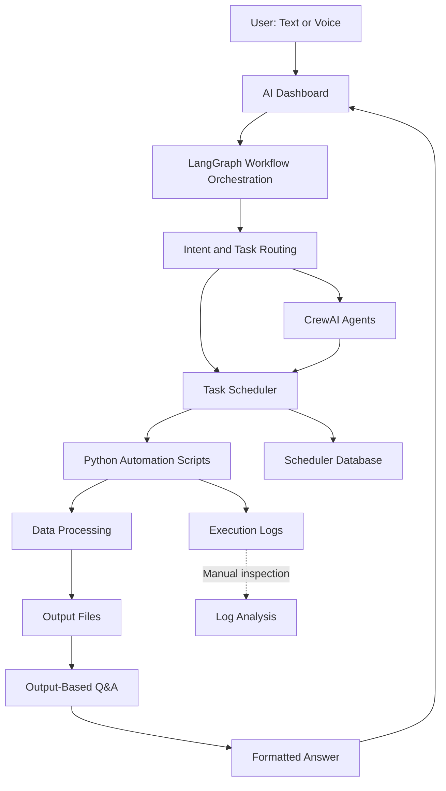

# 🚀 Next-Gen Agentic AI System

### Intelligent Workflow Orchestration | Autonomous Task Scheduling | Execution Monitoring | Output-Driven Q&A

**Powered by LangGraph and CrewAI**

An Agentic AI platform designed to orchestrate workflows, automate scheduled tasks, monitor execution, and answer natural-language questions directly from generated output files.

The system combines workflow orchestration, task scheduling, Python-based automation, execution monitoring, and AI-powered output analysis in a unified dashboard.

---

## 🎯 Project Overview

The Next-Gen Agentic AI System enables users to interact with automated tasks using natural-language commands. Instead of manually running scripts, checking reports, and interpreting output files, users can request a task and ask questions about its results through a single interface.

The system integrates **LangGraph** for workflow orchestration and **CrewAI** for multi-agent capabilities, alongside Python automation and a database-backed task scheduler.

## ✨ Key Features

### 1. 🧠 Intelligent Workflow Orchestration
- Uses LangGraph to structure and manage agent workflows.
- Interprets user requests and determines the appropriate action.
- Organizes task execution into defined workflow steps.

### 2. 🤖 Multi-Agent AI Architecture
- Integrates CrewAI for agent-based task analysis and monitoring capabilities.
- Supports specialized agent responsibilities.
- Enables modular expansion of AI capabilities.

### 3. ⏰ Autonomous Task Scheduling
- Runs configured Python automation tasks.
- Supports scheduled and on-demand execution through the scheduler.
- Uses database-backed task configuration and execution requests.
- Includes duplicate-run protection in the dashboard workflow.

### 4. 📊 Execution Monitoring
- Tracks task status and execution progress.
- Supports log and output inspection when required.
- Helps identify execution failures and operational issues.

### 5. 💬 Output-Driven Question Answering
- Reads available task output files.
- Answers natural-language questions using generated results.
- Supports data summaries, report interpretation, and result-based responses.
- Reduces the need to open and manually inspect output files.

### 6. 🖥️ Interactive AI Dashboard
- Natural-language command interface.
- Task management and scheduler status visibility.
- Formatted answers and tabular output presentation.
- Clear Screen option for a fresh conversation.
- Voice responses using the OpenAI text-to-speech API, subject to API access and configuration.

### 7. 🔄 Python Data Automation
- Automates repetitive data-processing workflows.
- Supports integration with scripts, databases, CSV files, Excel files, and other configured data sources.
- Designed to accommodate reporting and data-engineering use cases.

---

## 🏗️ System Architecture



**Architecture note:** The diagram represents the intended integration of the platform's components. The precise division of responsibilities depends on the configured workflow and available agents.

## 🛠️ Technology Stack

| Component | Technology |
|---|---|
| Programming language | Python |
| Workflow orchestration | LangGraph |
| Multi-agent framework | CrewAI |
| AI language models | OpenAI API, using supported models |
| Voice generation | OpenAI Text-to-Speech API |
| Task configuration and storage | SQLite / Access DB, depending on the configured workflow |
| Data processing | Pandas, Polars, DuckDB, as required by individual scripts |
| Dashboard | HTML, CSS, JavaScript |
| Backend API | Flask |
| Data outputs | CSV, Excel, Parquet, and configured files |

## 🔄 End-to-End Workflow

1. **User request:** The user enters a command, such as asking the system to run an IPO data collector.
2. **Intent interpretation:** The AI determines the requested action and relevant task.
3. **Workflow orchestration:** LangGraph manages the configured workflow and routing.
4. **Task execution:** The scheduler queues the task, and the configured Python process executes it.
5. **Execution tracking:** The dashboard observes task status until execution reaches a terminal state.
6. **Output retrieval:** The system accesses the relevant output file generated by the task.
7. **Question answering:** The AI uses the available output data to answer the user's question.
8. **Result presentation:** The dashboard displays a readable answer, summary, or table.

The run-and-answer workflow is designed to avoid unnecessary log-analysis interruptions. Log scanning can be performed separately when required.

## 💡 Example Use Case

**User command**

> Run IPO*DATA*COLLECTOR and tell me the result.

**Expected workflow**

- Identify the configured task.
- Queue the task once.
- Wait for execution to finish.
- Read the output produced by that execution.
- Present the IPO results in a formatted response.

**Follow-up question**

> How many open IPOs are in the latest output file?

The system can answer from the output data, provided the task output is configured and accessible.

## 🔐 Configuration and Security

- Store API keys in environment variables rather than source code.
- Do not commit `.env` files, passwords, database credentials, or sensitive business data.
- Use `.env.example` to document required configuration variables.
- Restrict access to internal databases, logs, and generated reports.
- Keep API keys and sensitive output files out of public repositories.

## ⚙️ Setup

The following is a general setup outline. Required dependencies and configuration depend on the project's current files.

### Prerequisites

- Python installed on the target machine.
- Git installed for repository management.
- Access to the required OpenAI API models.
- Configured task database and Python scripts.
- Required environment variables.

### Installation

Clone the repository:

```bash
git clone https://github.com/YOUR_USERNAME/next-gen-agentic-ai-scheduler.git
cd next-gen-agentic-ai-scheduler
```

Create a virtual environment:

```bash
python -m venv .venv
```

Activate it on Windows:

```powershell
.venv\Scripts\Activate.ps1
```

Install the project dependencies:

```bash
pip install -r requirements.txt
```

Configure the required environment variables using the supplied example file. Keep your actual API keys private.

Run the dashboard using the project's configured startup script, if provided.

> **Note:** Confirm the actual repository structure, dependency file, database path, and environment variables before publishing these instructions as a verified installation guide.

## 📈 Potential Applications

- Business report automation
- IPO data collection and analysis
- Scheduled Python workflows
- Automated data processing and reporting
- AI-powered operational dashboards
- Output-based analytics and question answering
- Enterprise task orchestration

## 🚀 Future Enhancements

- Expanded multi-agent collaboration.
- More robust workflow retries and failure recovery.
- Improved structured output validation.
- Additional data-source integrations.
- Role-based access control and audit trails.
- More detailed execution metrics and observability.
- Automated testing and deployment pipelines.

## 👨‍💻 Project Goal

To build a practical Agentic AI platform that combines intelligent orchestration, automated task execution, monitoring, and output-driven question answering—turning traditional scripts and scheduled jobs into a more interactive, AI-assisted automation system.

---

**Core technologies:** Python · LangGraph · CrewAI · Flask · OpenAI API · Task Scheduling · Data Automation · Agentic AI
